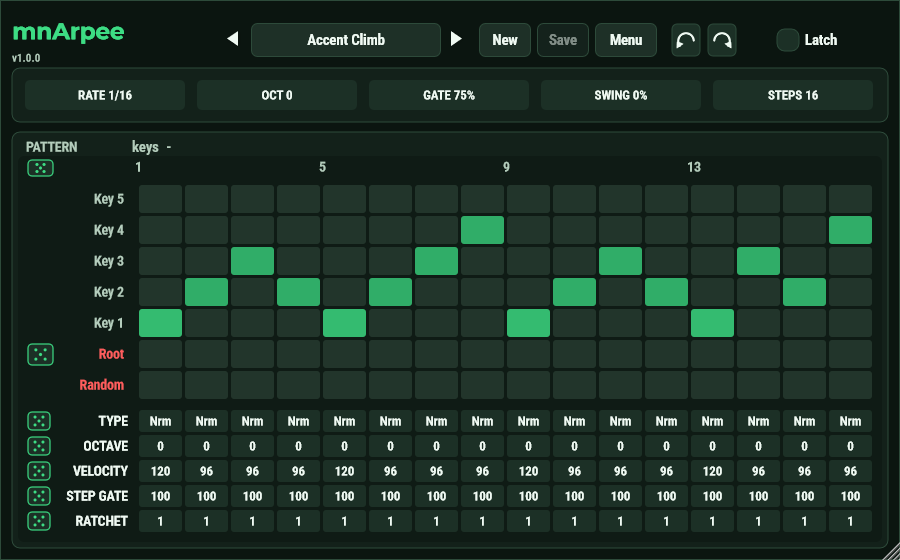
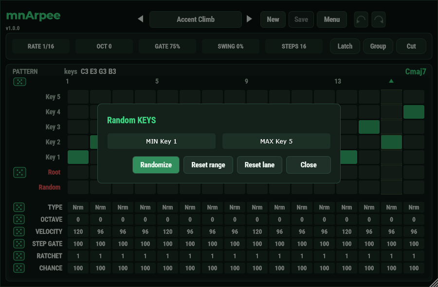
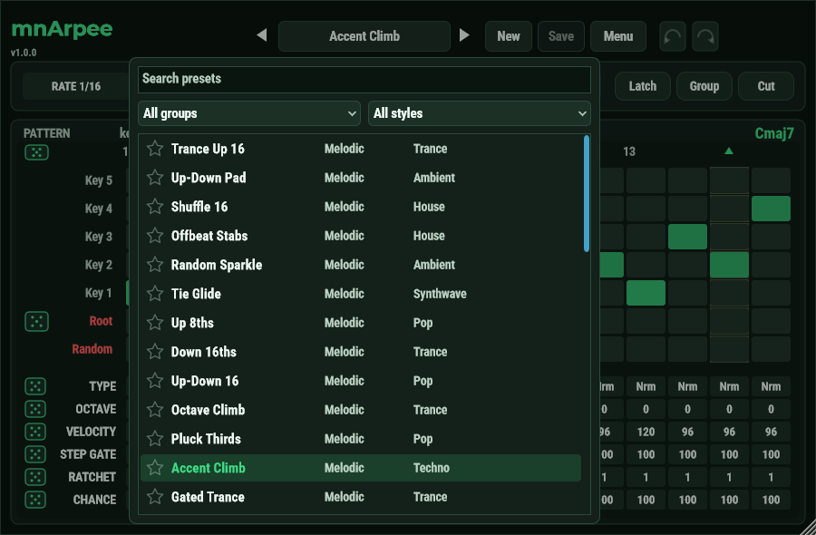

# mnArpee felhasználói útmutató

[English](USER_GUIDE.md) · **Magyar** · [Dokumentáció főoldal](README.md)

Az mnArpee egy pattern-arpeggiátor. Lenyomsz egy akkordot, az mnArpee pedig egyes hangok mintájaként játssza le. Hangot
nem ad: tedd egy szintetizátor elé, és a szintetizátor játssza a hangokat.

```text
MIDI-billentyűzet  ->  mnArpee  ->  szintetizátor
 (akkordot tartasz)    (minta)      (játssza a hangokat)
```

Nincsenek Up vagy Down jellegű arp-módok. A teljes mintát lépésről lépésre te rajzolod meg, vagy kiválasztasz egy gyári
presetet, és átalakítod.

## Telepítés

**Windows:** futtasd a `mnArpee-<verzió>-win-x64-setup.exe` fájlt. A plugin (VST3) a
`C:\Program Files\Common Files\VST3\MNAudio\` mappába kerül (ez a szabványos VST3-mappa saját almappája, amit a DAW-ok
átvizsgálnak). Ha nem jelenik meg, indíts új pluginkeresést a DAW-ban. A Standalone program nincs a telepítőben.

A licenc, a readme és ez az útmutató (PDF, Start menü-parancsikonokkal) a `C:\Program Files\MNAudio\mnArpee` mappába kerül. Új verziót a régi fölé is telepíthetsz: a
Setup kiírja, melyik verziót találta ("Upgrade: v1.0.0 -> v1.1.0"), régebbire visszalépés előtt rákérdez, és kéri, hogy
zárd be a DAW-ot, ha az mnArpee be van töltve.

Eltávolítás: *Beállítások → Alkalmazások → mnArpee → Eltávolítás*. A saját presetjeid (lásd lent) megmaradnak.

## Használat DAW-ban

1. Hozz létre egy **sávot**, és tedd rá az **mnArpee**-t.
2. Az a szintetizátor, amelyik a hangokat játssza, az mnArpee **után** kerüljön, ugyanarra a sávra (vagy kösd az mnArpee
   MIDI-kimenetét a szintetizátor sávjára). Hogy ez hogyan megy, DAW-onként más: keresd a "MIDI effect" vagy a
   "MIDI output routing" részt a DAW kézikönyvében.
3. Játssz le vagy tarts egy akkordot. Az mnArpee a kiválasztott preset mintáját játssza. Ami nem hang (pitch bend,
   moduláció, szusztain pedál, ...), az átmegy, és a hangok azon a csatornán mennek ki, amelyiken beérkeztek.

Amikor a DAW játszik, a lépések a dal pozíciójához igazodnak, így a minta mindig az ütemrácshoz illeszkedik. Álló
transzportnál az mnArpee saját tempóórával fut, és egy új akkord azonnal elindítja a mintát.

## Az ablak



Fentről lefelé:

- **Fejléc.** A logó a verzióval, a preset-választó (a nyilak, a preset neve, **New**, **Save**, **Menu**), a
  visszavonás és az újra gomb, és a **Latch**.
- **Értékek.** A minta RATE, OCT, GATE, SWING és STEPS értéke. Húzd az értéket fel vagy le, vagy használd az egérgörgőt.
  Az oldalirányú mozgás nem csinál semmit, így az érték nem ugrál, ha mozgatod az egeret.
- **PATTERN.** A lenyomott hangok és az akkord, amit alkotnak (Cmaj7, Am, C/E, G5, ...).
- **A key-mátrix.** Minden oszlop egy lépés; a sorok mondják meg, melyik hangot játssza a lépés.
- **A sávok.** A mátrix alatt: TYPE, OCTAVE, VELOCITY, STEP GATE és RATCHET, lépésenként egy-egy mezővel.

A pluginnak **nincsenek billentyűparancsai**. Soha nem vesz el egy billentyűt a DAW-tól.

## A key-ek

Az mnArpee nem ismeri előre a hangjaidat, ezért egy lépés nem azt mondja, hogy "C", hanem hogy "az első key", "a második
key" és így tovább. A key-ek a lenyomott hangok:

- A lenyomott hangok magasság szerint rendezettek. A **Key 1** a legalsó hang, a **Key 2** a következő, egészen a
  **Key 5**-ig.
- Hangnevenként egy key van: ugyanaz a hang más oktávban egynek számít, és a legalsó marad.
- Ha öt különböző hangnál többet tartasz, a legalsó öt a key, a többi kimarad. A PATTERN sáv mutatja a lenyomott
  hangokat: a **fehér** egy key, a **halvány** egy másik oktávú key-be olvadt, a **piros** kimaradt ("+N left out").
- A **Root** a lenyomott akkord alaphangját játssza. Érti a hármashangzatokat, a sus akkordokat, a szeptimeket, a power
  chordot és a fordításokat is. Ha nem talál akkordot, a legalsó hang a root.
- A **Random** véletlenszerűen választ a key-ek közül.
- Az a key, amelyet nem tartasz (a mintában van Key 4, de te három hangot nyomsz), a **rootot** játssza helyette. Így a
  minta bármilyen akkordon jól szól.

Kattints egy mátrixcellára, és a lépés arra a sorra kerül. Ugyanarra a cellára újra kattintva a lépés kikapcsol. A Random
sor ugyanígy működik: kattintásra a lépés véletlen lesz, újabb kattintásra kikapcsol.

## A sávok

| Sáv | Mit csinál |
|---|---|
| **TYPE** | `Nrm` normál hang, `Off` a lépés néma, `Rst` szünet, `Tie` legato, `Rnd` véletlen key. |
| **OCTAVE** | -3 és +3 oktáv között a lépésre. |
| **VELOCITY** | 1 és 127 között. |
| **STEP GATE** | A lépés hangjának hossza: a minta GATE-jének 10 és 400 %-a, 5 %-os lépésekben. A 100 = változatlan. |
| **RATCHET** | 1 és 4 között. A lépés annyiszor játssza le a hangját, egyenletesen elosztva a lépésen belül. |

Húzz egy mezőt fel vagy le, vagy használd az egérgörgőt. A sáv előtti **kocka** véletlen értékekkel tölti ki az egész sávot.

A **Rest** egy lépéssel megnyújtja az előtte lévő hangot. A **Tie** legato: az új hang az előző vége előtt indul, és az
önmagával összekötött hang új támadás nélkül szól tovább.

### Két gate

A fejléc **GATE** értéke az egész minta hanghossza a lépés százalékában (1 és 125 % között). A **STEP GATE** ezt skálázza
az egyes lépésekre. A hang hossza GATE x STEP GATE. 100 % felett a hangok átfedik egymást, ami legato
futamokhoz jó.

### Véletlen tartományok

Jobb kattintás egy kockán: megnyílik egy panel, ahol megadhatod a legkisebb és a legnagyobb értéket (**MIN** és **MAX**),
amit a kocka használhat. A **Randomize** egyszerre kitölti a sávot, a **Reset range** visszaadja az alap tartományt, a
**Reset lane** pedig az alapértékekre állítja a sávot. A tartományokat a projekt elmenti.



### A basszus-kocka

A **Root** sor kockája véletlen **basszusmenetet** csinál: csak Root lépésekből, hangsúlyokkal, szellemhangokkal,
szünetekkel, csúsztatásokkal, oktávugrásokkal és ratchetekkel. A sorok nevei feletti sarokban lévő kocka a
key-eket tölti ki véletlenszerűen.

## A fejléc értékei

| Érték | Tartomány | |
|---|---|---|
| **RATE** | 1/64 – 3/8 | A lépés hossza az ütem törtrészeként. |
| **OCT** | -2 – +2 | Az egész mintát oktávokkal tolja el. |
| **GATE** | 1 – 125 % | A minta hanghossza. |
| **SWING** | -50 – +50 % | Minden második lépést késleltet (vagy siettet). |
| **STEPS** | 0 – 32 | A minta hossza. A `0` MIDI thru, az `1` kvantált thru. |

16 lépésnél rövidebb mintánál a vég utáni oszlopok halványak, és nem használhatók.

Ezek az értékek mindig az aktív presethez tartoznak. Ha módosítasz egyet, a preset neve mellett megjelenik a mentetlen
változás pontja.

A **Latch** a billentyűk elengedése után is tovább játszatja az arpeggiót. Az új akkord felváltja a lecsapott
akkordot. A **szusztain pedál** is működik, a hoszt **panic** (all notes off) üzenete pedig azonnal leállít mindent.

## Minta-eszközök

Jobb kattintás a mátrixon vagy egy értékmezőn:

- **Set all steps to** a rákattintott érték
- A sáv **Randomize** (véletlenszerű kitöltése)
- **Generate keys**: Up, Down, Up-Down, Down-Up, Converge vagy Random, 3, 4 vagy 5 key-en
- **Random bass line (root only)**
- **Shift pattern left / right**, **Reverse pattern**, **Clear pattern**
- **Copy pattern** és **Paste pattern**. A minta a rendszer vágólapjára kerül preset-XML-ként, így beillesztheted egy
  másik plugin-ablakba, vagy elküldheted valakinek.

A **visszavonás** és az **újra** (a két kerek nyíl a fejlécben) minden lépés-szerkesztést visszavesz.

## Presetek



Kattints a preset nevére a **böngésző** megnyitásához: minden presetet listáz csoporttal és stílussal, kereséssel,
csoportszűrővel (All groups, Favorites, Bassline, Melodic, User) és stílusszűrővel. A **csillagra** kattintva a preset
kedvenc lesz; a csillagokat minden projekt közösen használja. A név melletti nyilak végiglépkednek a preseteken. A lista
egy elemén jobb kattintással: **Load**, **Duplicate**, **Rename**, **Show in folder** és **Delete**.

- A **Bassline** presetek csak a lenyomott akkord rootját játsszák. A **Melodic** presetek a lenyomott key-eket.
- Minden presetnek vannak stílus-címkéi: Trance, House, Techno, Disco, Funk, Pop, Synthwave, Ambient, Chill, Dubstep.
- A preset **a futó minta végén** vált, így a váltás sosem töri meg a ritmust.
- A gyári presetek csak olvashatók. Szerkeszd, és a **Save as** gombbal mentsd el a saját változatodat.

A fejléc gombjai:

- A **New** új mintát indít, amelyben minden lépés a Key 1-et játssza.
- A **Save** kiírja az aktív presetet. A preset nevén lévő pont mentetlen változást jelez. Mentetlen változásokkal teli
  preset elhagyásakor a program rákérdez, hogy mented-e.
- A **Menu**: *Save as* (a nevet és a stílusokat kéri), *Revert*, *Rename*, *Style*, *Import*, *Export*,
  *Show in folder*, *Zoom* (80–200 %, a projekttel együtt mentődik) és *Delete*.

### Hol vannak a presetek

A presetek a `Documents\MNAudio\mnArpee` mappában vannak:

| Mappa | Tartalma |
|--------|----------|
| `Factory` | A beépített presetek. A plugin írja, és ha változnak, újraírja őket. |
| `User` | A mentett presetjeid, presetenként egy `.xml` fájl, minden projekt közösen használja. Dobj be egy fájlt, és a böngésző következő megnyitásakor megjelenik. |

Az **Import** egyetlen presetet vagy sok presetet tartalmazó bank-fájlt is elfogad. A **Delete** a fájlt a Lomtárba teszi.

A DAW-projekt az **aktív preset tartalmát** tárolja, nem hivatkozást, ezért minden gépen ugyanúgy szól. Ott a preset
mentetlenként tér vissza, ha a könyvtár nem ismeri, és a **Save** az adott gép `User` mappájába írja.

### Hoszt-programok

A hoszt programlistája tükrözi a presetlistát (128 hely), így a programváltás és az automatizálás ugyanazt a presetet
választja. A használaton kívüli helyek "-"-t mutatnak.

## Tippek

- Akkordmenetből basszusmenet: válassz egy **Bassline** presetet, tartsd az akkordot, és minden akkord rootja követi.
- Indulj egy gyári presetből, és módosíts két-három lépést ahelyett, hogy a nulláról rajzolnál.
- Tegyél a VELOCITY-re véletlen tartományt (például 80–127), és nyomd meg a kockát: gyors út az emberi érzethez.
- Az ötkey-s minta háromhangos akkordon is jól szól, mert a hiányzó key-ek a rootot játsszák.
- Használj RATCHET 2-t vagy 3-at egyes lépéseken pergetéshez, és 200 % vagy nagyobb STEP GATE-et olyan hangokhoz, amelyek
  átnyúlnak a következő lépésre.

## Hibaelhárítás

- **A plugin nem jelenik meg.** Indíts új pluginkeresést a DAW-ban. A VST3 a
  `C:\Program Files\Common Files\VST3\MNAudio\` mappában van.
- **Nincs hang.** Az mnArpee nem ad hangot. Nézd meg, hogy van-e utána szintetizátor ugyanazon a sávon, és hogy a
  szintetizátor arra a MIDI-csatornára hallgat-e, amelyen játszol.
- **Néhány lépésen nem szólnak a hangok.** A lépés lehet `Off` vagy `Rst` (vagy `Tie` ugyanarra a hangra, ami új támadás
  nélkül szól tovább).
- **Nem látszik az akkord.** Tartsd lenyomva a hangokat: a PATTERN sáv csak a lenyomott hangokat mutatja.

## Fordítás forráskódból

A fordításról, a tesztekről és a telepítőről lásd a [README](../README.md#build-windows)-t. Az mnArpee szabad szoftver
az AGPL-3.0 alatt, [JUCE](https://juce.com) alapon készül.
